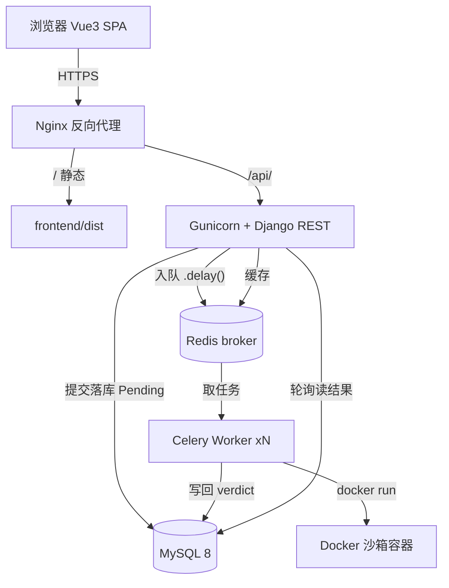

# 生产部署方案（任务 2 + 任务 3）

> 把平台部署到一台租用的 Linux 服务器，面向**全校师生**稳定运行。
> 本文同时覆盖：**任务 3 — 部署架构图**（§0）与 **任务 2 — 部署配置**（§2 起，Gunicorn + Nginx + Celery + Docker Compose 实配）。
> 后端「怎么实现的」见 `docs/07-后端架构与评测流水线.md`；本文只讲「怎么上线」。

---

## 0. 部署架构总览（任务 3）

### 0.1 拓扑图

```
                          ┌─────────────────────────────────────────────┐
                          │            一台 Linux 服务器 (Ubuntu)         │
   浏览器                 │                                               │
 (Vue 3 SPA) ── HTTPS ──▶ │  Nginx ┬─ /            → frontend/dist 静态    │
                          │        ├─ /api/        → Gunicorn (Django)    │
                          │        ├─ /api/ai/ask/ → Gunicorn（关缓冲,SSE）│
                          │        └─ /static/,/media → 静态文件           │
                          │                │                              │
                          │                ▼                              │
                          │          Gunicorn (gthread)                   │
                          │           Django REST API                     │
                          │                │ 提交→落库 Pending→入队        │
                          │                ▼                              │
                          │            Redis（broker + 缓存）             │
                          │                │ 取任务                       │
                          │                ▼                              │
                          │     Celery Worker（并发 = N 个评测）          │
                          │                │ docker run（每次一个容器）    │
                          │                ▼                              │
                          │       Docker 沙箱（acm-oj-sandbox:latest）    │
                          │         --network=none / 内存/CPU/pids 限制    │
                          │                                               │
                          │            MySQL 8（数据持久化）              │
                          └─────────────────────────────────────────────┘
```

### 0.2 Mermaid 版（论文/答辩可直接渲染）



### 0.3 组件职责

| 组件 | 角色 | 进程/容器 |
|------|------|-----------|
| Nginx | HTTPS 终止、静态托管、反向代理、SSE 关缓冲 | 系统服务 |
| Gunicorn | 跑 Django WSGI，处理所有 `/api/` 请求 | systemd 服务 |
| Celery Worker | 消费评测 / AI 反馈任务，调度 Docker 沙箱 | systemd 服务 |
| Redis | Celery broker + result backend + Django 缓存 | 系统服务 |
| MySQL 8 | 业务数据持久化 | 系统服务 |
| Docker 沙箱 | 每次提交起一个隔离容器编译运行学生代码 | Worker 临时拉起 |

### 0.4 两条关键数据流

**① 普通请求**：浏览器 → Nginx → Gunicorn → MySQL → 返回 JSON。

**② 代码评测（异步）**：
```
提交 → Gunicorn 落库(Pending) + judge_submission_task.delay() → 立即返回 submission_id
                                          ↓ Redis 队列
                       Celery Worker 取任务 → 置 Judging → docker run 编译+逐测试点
                                          ↓ 写回 verdict（AC/WA/...）+ 触发 AI 反馈任务
前端每 2s 轮询 GET /api/submissions/<id>/ → 状态非 Pending/Judging 即停止
```

> **为什么评测必须异步**：评测是 CPU 重活（每次起 Docker 容器），全班同一分钟交卷会瞬间打爆机器。Worker 并发数 `N` 就是「同时最多几个评测」的硬闸门。详见 `docs/07`。

---

## 1. 部署前提

| 项 | 要求 | 说明 |
|----|------|------|
| 操作系统 | **Linux（Ubuntu 22.04 LTS）** | Docker 沙箱依赖 Linux；Windows 的直跑模式**无隔离**，严禁上生产 |
| 沙箱 | `USE_DOCKER_SANDBOX=True` | 学生代码必须在容器里跑，否则可读写服务器文件 |
| 域名 + 证书 | 一个域名 + Let's Encrypt | JWT/Cookie、考试切屏监测都建议走 HTTPS |
| 配置基线 | 4 vCPU / 8GB（小院系）起步 | 全校统考建议评测单独一台，见 §4 |

---

## 2. 方案 A：单机 + systemd（**首选**，最省心）

> 适合「先把全校用起来」。Web、Worker、Redis、MySQL 都装在一台 Ubuntu 上，
> Celery Worker 直接用**宿主机的 Docker**，避开容器套容器的坑（见 §3 说明）。

### 2.1 安装系统依赖

```bash
sudo apt update
sudo apt install -y python3-venv python3-dev build-essential \
                    mysql-server redis-server nginx git \
                    pkg-config default-libmysqlclient-dev
# Docker（沙箱用）
curl -fsSL https://get.docker.com | sudo sh
sudo systemctl enable --now docker redis-server mysql
```

### 2.2 拉代码、建虚拟环境、装依赖

```bash
sudo mkdir -p /srv/acm_oj && sudo chown $USER /srv/acm_oj
git clone <你的仓库地址> /srv/acm_oj
cd /srv/acm_oj
python3 -m venv .venv
.venv/bin/pip install -r requirements.txt
.venv/bin/pip install gunicorn          # 生产 WSGI 服务器
```

### 2.3 初始化数据库

```bash
sudo mysql -e "CREATE DATABASE acm_oj CHARACTER SET utf8mb4 COLLATE utf8mb4_unicode_ci;"
sudo mysql -e "CREATE USER 'acm'@'localhost' IDENTIFIED BY '强密码';"
sudo mysql -e "GRANT ALL ON acm_oj.* TO 'acm'@'localhost'; FLUSH PRIVILEGES;"
```

### 2.4 生产 `.env`

在 `/srv/acm_oj/.env`（**禁止提交**，参考 `.env.example`）：

```ini
SECRET_KEY=<python -c "from django.core.management.utils import get_random_secret_key as g; print(g())">
DEBUG=False
ALLOWED_HOSTS=oj.your-school.edu.cn

DB_NAME=acm_oj
DB_USER=acm
DB_PASSWORD=强密码
DB_HOST=127.0.0.1
DB_PORT=3306

CORS_ORIGINS=https://oj.your-school.edu.cn

# 沙箱必须开
USE_DOCKER_SANDBOX=True
JUDGE_DOCKER_IMAGE=acm-oj-sandbox:latest

# Celery：生产走真实队列（DEBUG=False 时默认就是 False，可不写）
REDIS_URL=redis://127.0.0.1:6379/0
CELERY_TASK_ALWAYS_EAGER=False
CELERY_WORKER_CONCURRENCY=4          # = 同时最多几个评测，按 CPU 核数调，见 §4

# AI 反馈/RAG（可选）
LLM_API_KEY=...
LLM_API_URL=...
LLM_MODEL=...
```

### 2.5 迁移 + 收集静态 + 构建前端

```bash
cd /srv/acm_oj
.venv/bin/python manage.py migrate
.venv/bin/python manage.py collectstatic --noinput
# 前端打包（产出 frontend/dist，被 Django/Nginx 托管）
cd frontend && npm ci && npm run build
```

### 2.6 构建评测沙箱镜像

```bash
cd /srv/acm_oj
docker build -f Dockerfile.sandbox -t acm-oj-sandbox:latest .
# 让运行 worker 的用户能调 docker（免 sudo）
sudo usermod -aG docker $USER   # 重新登录生效
```

### 2.7 Gunicorn —— systemd 服务

`/etc/systemd/system/acm-web.service`：

```ini
[Unit]
Description=ACM OJ Gunicorn
After=network.target mysql.service redis-server.service

[Service]
User=www-data
WorkingDirectory=/srv/acm_oj
Environment=DJANGO_SETTINGS_MODULE=acm_oj.settings
# gthread：SSE（/api/ai/ask/）需要线程型 worker，sync worker 会被流式响应占死
ExecStart=/srv/acm_oj/.venv/bin/gunicorn acm_oj.wsgi:application \
    --workers 3 --worker-class gthread --threads 4 \
    --bind 127.0.0.1:8000 --timeout 120
Restart=always

[Install]
WantedBy=multi-user.target
```

> Worker 数经验值：`2 × CPU 核数 + 1`，但要给评测 Worker 留 CPU（见 §4）。

### 2.8 Celery Worker —— systemd 服务（**关键**）

`/etc/systemd/system/acm-worker.service`：

```ini
[Unit]
Description=ACM OJ Celery Worker
After=network.target redis-server.service docker.service

[Service]
User=acm                       # 该用户须在 docker 组（§2.6）
WorkingDirectory=/srv/acm_oj
EnvironmentFile=/srv/acm_oj/.env
# -c 并发数 = 同时最多几个评测容器；Linux 用默认 prefork 池
ExecStart=/srv/acm_oj/.venv/bin/celery -A acm_oj worker \
    -l info -c 4 --max-tasks-per-child 200
Restart=always

[Install]
WantedBy=multi-user.target
```

另需一个 **Beat** 服务跑定时维护（回收卡死评测 / 清临时目录 / 清过期 token），`/etc/systemd/system/acm-beat.service`：

```ini
[Unit]
Description=ACM OJ Celery Beat
After=network.target redis-server.service

[Service]
User=acm
WorkingDirectory=/srv/acm_oj
EnvironmentFile=/srv/acm_oj/.env
ExecStart=/srv/acm_oj/.venv/bin/celery -A acm_oj beat -l info
Restart=always

[Install]
WantedBy=multi-user.target
```

启用：

```bash
sudo systemctl daemon-reload
sudo systemctl enable --now acm-web acm-worker acm-beat
sudo systemctl status acm-web acm-worker acm-beat
```

> 可选：`celery -A acm_oj flower --port=5555` 起任务监控面板（建议只绑内网或加 Nginx Basic Auth）。

### 2.9 Nginx 反向代理

`/etc/nginx/sites-available/acm_oj`：

```nginx
server {
    listen 80;
    server_name oj.your-school.edu.cn;

    client_max_body_size 10m;           # Excel 导入等

    # 前端 SPA
    root /srv/acm_oj/frontend/dist;
    index index.html;
    location / {
        try_files $uri $uri/ /index.html;   # Vue Router history 模式
    }

    # Django 静态（admin 等）
    location /static/ { alias /srv/acm_oj/staticfiles/; }

    # API
    location /api/ {
        proxy_pass http://127.0.0.1:8000;
        proxy_set_header Host $host;
        proxy_set_header X-Real-IP $remote_addr;
        proxy_set_header X-Forwarded-For $proxy_add_x_forwarded_for;
        proxy_set_header X-Forwarded-Proto $scheme;
    }

    # AI 问答是 SSE 流式：必须关掉缓冲，否则前端收不到逐字输出
    location /api/ai/ask/ {
        proxy_pass http://127.0.0.1:8000;
        proxy_set_header Host $host;
        proxy_buffering off;
        proxy_cache off;
        proxy_read_timeout 300s;
    }

    # Django admin
    location /admin/ {
        proxy_pass http://127.0.0.1:8000;
        proxy_set_header Host $host;
        proxy_set_header X-Forwarded-Proto $scheme;
    }
}
```

```bash
sudo ln -s /etc/nginx/sites-available/acm_oj /etc/nginx/sites-enabled/
sudo nginx -t && sudo systemctl reload nginx
```

### 2.10 HTTPS（Let's Encrypt）

```bash
sudo apt install -y certbot python3-certbot-nginx
sudo certbot --nginx -d oj.your-school.edu.cn   # 自动改写上面的 server 块为 443 + 自动续期
```

---

## 3. 方案 B：Docker Compose（进阶 / 可移植）

> 把 Web、Worker、Redis、MySQL、Nginx 全部容器化，一条命令起。**但评测沙箱有坑，先读 §3.2。**

### 3.1 `docker-compose.yml`

```yaml
services:
  web:
    build: .
    command: gunicorn acm_oj.wsgi:application --workers 3 --worker-class gthread
             --threads 4 --bind 0.0.0.0:8000 --timeout 120
    env_file: .env
    depends_on: [db, redis]

  worker:
    build: .
    command: celery -A acm_oj worker -l info -c 4 --max-tasks-per-child 200
    env_file: .env
    depends_on: [db, redis]
    # ⚠️ 评测要调宿主机 Docker —— 见 §3.2
    volumes:
      - /var/run/docker.sock:/var/run/docker.sock
      - /srv/judge_tmp:/srv/judge_tmp        # 与宿主机同路径共享评测临时目录

  redis:
    image: redis:7-alpine

  db:
    image: mysql:8
    environment:
      MYSQL_DATABASE: acm_oj
      MYSQL_ROOT_PASSWORD: 强密码
    volumes: [db_data:/var/lib/mysql]

  nginx:
    image: nginx:alpine
    ports: ["80:80", "443:443"]
    volumes:
      - ./deploy/nginx.conf:/etc/nginx/conf.d/default.conf:ro
      - ./frontend/dist:/usr/share/nginx/html:ro
      - ./staticfiles:/srv/static:ro
    depends_on: [web]

volumes:
  db_data:
```

### 3.2 ⚠️ 沙箱与容器套容器（必读）

评测 Worker 要执行 `docker run` 起沙箱容器。Worker 自己在容器里时有两个坑：

1. **要能访问 Docker 守护进程** → 挂载 `/var/run/docker.sock`（Worker 容器里也要装 `docker` CLI）。这是「Docker-out-of-Docker」：起出来的沙箱是宿主机的**兄弟容器**，不是嵌套容器。
2. **挂载路径必须宿主机可见** → 沙箱用 `-v {tmp_dir}:/sandbox` 挂源码，这个 `tmp_dir` 由**宿主机 Docker** 解析。若 Worker 在容器内用 `tempfile.mkdtemp()` 建临时目录，该路径只存在于 Worker 容器里、宿主机看不到 → 挂进去是空的。
   **解法**：把评测临时目录放在 Worker 容器与宿主机**同路径**的共享卷（上面 `/srv/judge_tmp`），并让 `judger.py` 用 `tempfile.mkdtemp(dir=settings.JUDGE_TEMP_DIR)`（当前代码没传 `dir=`，容器化前需补这一处）。

> **结论 / 建议**：即使用 Compose 部署 Web，也**建议把 Celery Worker 留在宿主机（systemd）**，避开上述两个坑——Worker 直接用宿主机 Docker、临时目录天然是宿主机路径，最简单可靠。Compose 只管 Web/Nginx/Redis/MySQL。

挂载 `docker.sock` 等于把宿主机 root 权限给了 Worker 容器，是已知安全弱点；宿主机 Worker 没这个问题，这也是首选方案 A 的原因之一。

---

## 4. 容量与并发调参

| 参数 | 含义 | 建议 |
|------|------|------|
| `CELERY_WORKER_CONCURRENCY`（`-c`） | 同时最多几个评测容器 | = 评测可用 CPU 核数（留 1~2 核给 Web/系统）。4 核机 → 3~4 |
| Gunicorn `--workers` | 同时处理几个 HTTP 请求 | `2×核数+1`，但与评测争 CPU 时下调 |
| 每个沙箱 `--memory` | 单次评测内存上限 | 由题目 `memory_limit` 决定，并发数 × 上限不要超总内存 |
| MySQL `max_connections` | DB 连接数 | Gunicorn workers + Celery 并发 + 余量 |

**全校统考洪峰**：N 个并发评测会把队列排起来，学生看到 Pending 稍久但机器不崩——这正是异步队列的目的。要更快出分就**加评测机**：把 `acm-worker.service` 部署到第二台 8 核机器，`.env` 里 `REDIS_URL` 指向主机 Redis（开放 6379 给内网 + 设密码）。**Web 不用动**，这就是拆分扩容的全部代价。

---

## 5. 上线检查清单

- [ ] `DEBUG=False`、`ALLOWED_HOSTS` 填真实域名、`SECRET_KEY` 是新生成的
- [ ] `USE_DOCKER_SANDBOX=True`，沙箱镜像已 `docker build`
- [ ] `CELERY_TASK_ALWAYS_EAGER=False`，`acm-worker` 服务在跑（`systemctl status`）
- [ ] 提交一份代码 → 能看到状态 Pending → Judging → AC，worker 日志有评测记录
- [ ] 故意写死循环 → 判 TLE；故意开大数组 → 判 MLE（验证沙箱限制生效）
- [ ] HTTPS 证书有效、HTTP 自动跳 HTTPS
- [ ] AI 问答能逐字流式输出（验证 Nginx SSE 关缓冲生效）
- [ ] `.env` 不在 git 里；MySQL/Redis 未暴露公网（或已设密码 + 防火墙）
- [ ] 重启服务器后 `acm-web`/`acm-worker`/nginx/redis/mysql/docker 全部自启

---

## 6. 日常运维

```bash
# 看日志
sudo journalctl -u acm-web -f
sudo journalctl -u acm-worker -f

# 发布新版本
cd /srv/acm_oj && git pull
.venv/bin/pip install -r requirements.txt
.venv/bin/python manage.py migrate
.venv/bin/python manage.py collectstatic --noinput
cd frontend && npm ci && npm run build && cd ..
sudo systemctl restart acm-web acm-worker      # 重启不丢任务：在途任务在 Redis 里

# 备份数据库（建议加进 crontab 每日）
mysqldump -u acm -p acm_oj | gzip > /backup/acm_$(date +%F).sql.gz
```

---

## 7. 安全清单（面向全校开放必看）

- 学生代码**只在 Docker 沙箱**跑（`--network=none` 断网、内存/CPU/进程数全限），细节见 `docs/07` §4。
- 关掉对外的 MySQL/Redis 端口，或绑 `127.0.0.1` + 防火墙（`ufw`）。
- 提交接口已限代码长度（64KB）；如遇刷题攻击可加 Nginx `limit_req` 限速。
- 自动建号的学生（Excel 导入）首登强制改密（`must_change_password` 已实现）。
- 定期 `git pull` + `pip install` 跟进 Django 安全更新。

---

## 待办（部署相关）

- ✅ **旧同步评测口已堵上**：`submit_code` / `custom_run`（旧模板）与 `CustomRunAPIView`（自定义运行）均已改走 Celery 任务，不再在请求线程里同步执行。
- [ ] 容器化 Worker 前需给 `judger.py` 的 `mkdtemp` 补 `dir=settings.JUDGE_TEMP_DIR`（§3.2）。
- [ ] 压测：模拟全班并发交卷，确认队列与沙箱稳定（06 文档亦列此项为最高优先级）。
